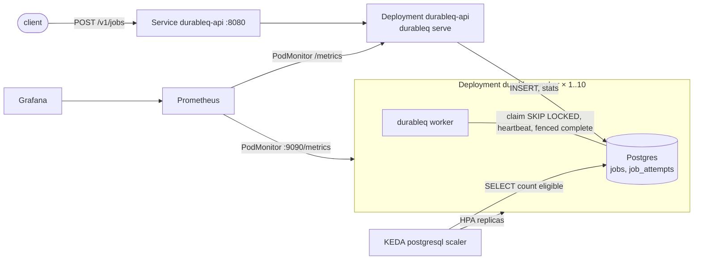

# DurableQ on Kubernetes

DurableQ runs as an HTTP API plus N worker pods, all from one image. The Helm chart deploys them, KEDA scales the workers on the backlog in Postgres, and Prometheus and Grafana show what the queue is doing. Postgres is still the only coordinator: Kubernetes decides how many workers run, and the database decides which worker owns which job.

Decisions and their rationale: [PRD §16](PRD.md#16-kubernetes-extension-2026-11-12). Plan and interface contract: [kubernetes-plan.md](kubernetes-plan.md). Measured results: [results-k8s.md](results-k8s.md).

## Architecture



| Component | What it is | Health semantics |
|---|---|---|
| `durableq-api` | `durableq serve`: job submission and status, plus queue-wide gauges on `/metrics` | `/healthz` = process alive (never checks the DB); `/readyz` = DB ping < 1s and not shutting down |
| `durableq-worker` | `durableq worker --http-addr :9090` with the demo handlers | Same. A DB outage makes the pod unready but never kills it: the worker keeps retrying its claims and recovers on its own |
| `durableq-postgres` | Dev-only single-replica StatefulSet, `postgres:17`, 1 Gi PVC | `pg_isready` probes |
| Migrations | `durableq migrate` init container on API and worker pods (advisory-locked and idempotent) | A pod doesn't start until the schema is current |

## Quick start (kind, no cloud account)

Requires Docker, kind, kubectl, Helm, and Go 1.27 (for `make helm-lint` and tests). The full stack needs about 4 GB of Docker memory.

```sh
make kind-up        # cluster + metrics-server + KEDA + kube-prometheus-stack + image + chart (~5 min first time)
make k8s-smoke      # 200 jobs through the API, wait for drain, run invariants I1–I7 in-cluster
make kind-deploy    # after a code change: rebuild, kind load, roll the deployments
make kind-down      # delete the cluster
```

Pinned addon versions (in `scripts/kind-up.sh`): metrics-server chart 3.14.0, KEDA 2.21.0, kube-prometheus-stack 93.2.2. Tested with kind v0.33.0, Kubernetes v1.37.0, and Helm v4.3.1 locally (Helm v3.16 in CI).

Use the API:

```sh
kubectl -n durableq port-forward svc/durableq-api 8080:8080
curl -XPOST localhost:8080/v1/jobs -d '{"kind":"demo.effect","payload":{"sleep_ms":100},"idempotency_key":"order-42"}'
# {"id":1,"existed":false}      (201; the same key again → 200 with "existed":true)
curl localhost:8080/v1/jobs/1   # state, attempt, and the full attempt history
curl localhost:8080/v1/stats    # {"pending":0,"scheduled":0,"running":0,"lease_expired":0,"dead":0}
kubectl -n durableq exec deploy/durableq-api -c api -- /durableq check   # invariants, in-cluster
```

API reference: `POST /v1/jobs` takes `kind` (required, ≤ 200 chars), `payload` (a JSON object), `max_attempts` (1–100, default 5), `delay_ms` (≥ 0), and `idempotency_key` (≤ 200 chars). The body limit is 1 MiB; unknown fields → 400. There is no authentication: the Service is ClusterIP-only and the chart creates no Ingress. Put an authenticating proxy in front of it before exposing it.

### Docker Compose (no Kubernetes)

```sh
DURABLEQ_PG_PORT=55432 docker compose up -d --build --wait --scale worker=3 api worker
curl -XPOST localhost:8080/v1/jobs -d '{"kind":"demo.effect"}'
docker compose exec api /durableq check
```

## Helm

Chart: `deploy/helm/durableq`. Values files: `values.yaml` (defaults, documented inline), `values-kind.yaml` (local: KEDA, PodMonitor, and dashboards on), `values-ci.yaml` (no CRDs, tiny resources).

| Key | Default | Notes |
|---|---|---|
| `image.repository` / `image.tag` | `durableq` / `dev` | One image for API and worker |
| `database.existingSecret` / `database.secretKey` | `""` / `DATABASE_URL` | External Postgres: create a Secret with the URL, set this, and set `postgresql.enabled=false` |
| `api.replicas` / `api.maxConns` | 2 / 5 | |
| `worker.replicas` | 3 | Ignored when `autoscaling.enabled` |
| `worker.concurrency` / `worker.maxConns` | 10 / 6 | Jobs hold a connection only while claiming, heartbeating, or transitioning, so a pool smaller than the concurrency is enough |
| `worker.lease` / `worker.heartbeat` / `worker.grace` | 30s / 10s / 10s | Heartbeat must be < lease/2 (enforced by the binary) |
| `worker.terminationGracePeriodSeconds` | 30 | Must exceed `grace` by ≥ 5s (enforced at render time) |
| `autoscaling.*` | off; 1–10; poll 15s; cooldown 60s; 50 per replica; scale-down window 120s, at most 2 pods/min | KEDA, below |
| `metrics.podMonitor.enabled`, `grafana.dashboards.enabled` | off | Need the prometheus-operator CRDs and the Grafana sidecar |
| `postgresql.enabled` / `postgresql.maxConnections` | true / 200 | Dev only. The generated password survives `helm upgrade` (via `lookup`) and `helm uninstall` (`resource-policy: keep`), because the retained PVC keeps the old password. To start from scratch, delete the namespace or the PVC and the `durableq-db` Secret |

Render-time guards (`helm template` fails):
- **Connection budget:** `(autoscaling ? maxReplicas : worker.replicas) × worker.maxConns + api.replicas × api.maxConns + 10 ≤ postgresql.maxConnections`. With defaults: 10 × 6 + 2 × 5 + 10 = 80 ≤ 200. The default `concurrency+2` pool per worker would have needed 120 at 10 replicas, which is over Postgres's default `max_connections` of 100.
- **Grace:** `terminationGracePeriodSeconds ≥ grace + 5`, so the kubelet doesn't SIGKILL a worker while it is still draining.
- **Database:** either `existingSecret` or `postgresql.enabled`, not both.

Pod security: non-root (65532, distroless `static:nonroot`), `readOnlyRootFilesystem`, all capabilities dropped, `seccompProfile: RuntimeDefault`, no privilege escalation, `automountServiceAccountToken: false`. The DSN is only in a Secret, referenced by `secretKeyRef`; it never appears in ConfigMaps or args.

Static checks: `make helm-lint` runs `helm lint` and `helm template | kubeconform -strict` for every values file.

## What happens to jobs when Kubernetes stops a worker

Postgres decides who owns a job, and Kubernetes events only change which processes are alive. The guarantees are the ones in the [README](../README.md#guarantees): at-least-once execution, at most one terminal transition per job, fenced transitions, and exactly-once *transactional* effects through `CommitFunc`. They are not exactly-once *external* side effects.

| Event | What the worker sees | What happens to its jobs |
|---|---|---|
| Scale-down, rolling update, `kubectl delete pod`, node drain | SIGTERM | `/readyz` → 503 at once; stops claiming; waits up to `worker.grace` for in-flight jobs to finish; **releases** the rest (`state=queued`, `max_attempts+1`, so a deploy never pushes a job toward dead); stops heartbeats; closes the HTTP server and the DB pool; exits before `terminationGracePeriodSeconds` |
| OOM kill, node loss, `kill -9`, grace period exceeded | SIGKILL | Nothing runs. The leases expire on the database clock (≤ `worker.lease`), and any worker's next claim takes the jobs back with `attempt+1`. This counts as an attempt (D5) |
| Network partition or DB outage | Heartbeats fail | The worker cancels the job's context at its local deadline (lease − heartbeat after the last successful renewal is *sent*) and abandons the job without a transition; the database reclaims it after the lease |
| Paused (SIGSTOP, GC stall) past its lease, then resumed | Its completion arrives late | Rejected by the fence: `attempt` no longer matches, or the lease has expired. Counted in `durableq_stale_transitions_total` |

`kubectl delete pod --grace-period=0 --force` is **not** a SIGKILL. It removes the API object at once, but the kubelet still sends SIGTERM with a short grace before killing the process. The chaos suite kills processes with real SIGKILLs separately.

**Duplicate execution vs. duplicate effects.** Under SIGKILL or a partition, a handler can run more than once: the abandoned attempt and its reclaim. That is the at-least-once contract, and the chaos reports count it as "duplicate executions". A duplicate *committed* effect would be a bug. The completion transaction is fenced, so only the current owner's `CommitFunc` writes can commit. Invariants I2, I5 and I7 check this after every chaos run.

## Metrics and dashboards

Worker pods (`:9090/metrics`) export per-process counters and histograms. The API (`:8080/metrics`) exports queue-wide gauges from one SQL query per scrape. Only the API exports those gauges, so N workers don't multiply them (D14). Labels are only `kind` (registered handler kinds), `outcome`, `route` (the mux pattern), and `code`; no job IDs and no client-supplied values.

| Metric | Type | Meaning |
|---|---|---|
| `durableq_jobs_pending` / `_scheduled` / `_running` / `_lease_expired` / `_dead` | gauge (API) | Rows by state, each counted through a partial index; pending = queued and due; scheduled = queued with a future `run_at` (delays and retry backoff); `dead` is the dead-letter queue |
| `durableq_job_claims_total{kind}` | counter | Jobs claimed |
| `durableq_lease_expirations_total{kind}` | counter | Claims that took over an expired lease (a worker died or stalled) |
| `durableq_jobs_completed_total` / `_failed_total` / `_retried_total` / `_dead_lettered_total` / `_released_total{kind}` | counter | Attempt outcomes; failed = retried + dead-lettered |
| `durableq_lease_lost_total` / `durableq_stale_transitions_total{kind}` | counter | Worker abandoned a job / a fenced transition was rejected |
| `durableq_job_duration_seconds{kind,outcome}` | histogram | From claim to the attempt's outcome |
| `durableq_queue_wait_seconds{kind}` | histogram | Claim time minus `run_at`, on the DB clock (it excludes an intentional delay) |
| `durableq_worker_active_jobs`, `durableq_worker_concurrency` | gauge | In-flight jobs and slots per pod; the dashboard computes slot utilization from them |
| `durableq_jobs_enqueued_total`, `durableq_http_requests_total{route,code}` | counter (API) | |

Grafana: `kubectl -n monitoring port-forward svc/monitoring-grafana 3000:80`, log in as `admin`/`admin` (the local kind values only), and open **DurableQ overview** (uid `durableq-overview`). The dashboard has a health row (active workers, slot utilization, eligible backlog, completed/s, failure ratio, dead jobs), then queue depth by state, throughput, duration and queue-wait percentiles, worker replicas (spec, available, and the KEDA HPA's desired count), failures, retries and dead letters, and lease health. The JSON is `deploy/helm/durableq/dashboards/durableq.json`, shipped as a ConfigMap that the Grafana sidecar loads.

Prometheus: `kubectl -n monitoring port-forward svc/monitoring-kube-prometheus-prometheus 9090`.

## Autoscaling (KEDA)

KEDA's built-in PostgreSQL scaler runs this query every `pollingInterval` (15s):

```sql
SELECT count(*) FROM jobs
WHERE (state = 'queued' AND run_at <= clock_timestamp())
   OR (state = 'running' AND lease_expires_at < clock_timestamp())
```

It counts the work a worker could claim right now. That includes jobs due now and jobs whose lease expired (their worker died). It excludes scheduled and backoff jobs, whose `run_at` is in the future, and jobs held under a valid lease. With `metricType: AverageValue`, the HPA computes `desired = ceil(backlog / backlogPerReplica)`, clamped to `[minReplicas, maxReplicas]`.

**Why the PostgreSQL scaler and not Prometheus:** it reads the source of truth directly, so scaling still works when Prometheus is down or behind. Its cost is one indexed count every 15s and one connection.

**Raw queue depth vs. backlog per worker.** A raw-depth threshold (`metricType: Value`) asks "is the backlog above X?", and the HPA scales by the ratio current/target, which keeps growing as long as the backlog stays above the target. Backlog per replica (`AverageValue`) asks "how many workers would this backlog need?" and gives a proportional answer that doesn't depend on the current replica count. Backlog per replica is easier to reason about and tune: 50 means about 5 batches of work for a 10-slot worker. Neither counts jobs that are already running, so a deep backlog of short jobs and a shallow backlog of long jobs look different. For long jobs, lower `backlogPerReplica`.

**Scale-down safety.** The HPA sheds at most 2 pods per minute (`scaleDownMaxPodsPerMinute`) after a 120s stabilization window, not its default of 100% every 15s. Removing a replica sends SIGTERM, so in-flight jobs finish within `grace` or are released without using up their budget. Scale-down can't lose jobs: a released job is back in the queue at once, and a killed one comes back after its lease. The metric doesn't count running jobs, so once the backlog drains, the HPA scales down workers that are still busy. A job shorter than `worker.grace` finishes during the drain. A longer one is released and runs again from the start on another worker. For long jobs, raise `grace` and `terminationGracePeriodSeconds`, or lower `scaleDownMaxPodsPerMinute`. `cooldownPeriod` only governs KEDA's 1↔0 activation, so with `minReplicas ≥ 1` it has no effect; the HPA window and rate limit do the damping. With `minReplicas ≥ 1`, KEDA never scales to zero, so the first job after an idle period doesn't wait for a pod to start. Scale-to-zero (`minReplicas: 0`) works, but adds pod start time plus up to one polling interval to the first job's latency.

**Connection limits.** Every replica adds up to `worker.maxConns` connections, and the render-time budget check uses `maxReplicas`. KEDA's scaler uses one more connection, which fits in the slack of 10.

Watch it: `kubectl -n durableq get scaledobject,hpa -w` and the "Worker replicas" panel. Measured reaction times are in [results-k8s.md](results-k8s.md).

## Chaos and benchmarks on Kubernetes

See [results-k8s.md](results-k8s.md) for the commands, methodology, hardware, and measured results.

## Known limitations

- **No API authentication or TLS**, by design for a ClusterIP-only demo. Exposing the API needs an authenticating proxy or an Ingress with auth.
- **The in-chart Postgres is not production Postgres**: one replica, no backups, no HA. Use a managed or operator-run Postgres through `database.existingSecret`.
- **At-least-once, not exactly-once.** External side effects can repeat (see above). Ordering is not guaranteed.
- **Queue gauges count rows on every scrape.** Each count uses a partial index, so its cost grows with the live queue and the dead-letter set, not the history. There is no succeeded gauge: counting the unbounded history would be a full scan, so use `rate(durableq_jobs_completed_total)` instead. Nothing deletes finished jobs (retention is a PRD stretch item).
- **`durableq_queue_wait_seconds`** is measured from `run_at`. A reclaimed job's wait therefore includes its previous attempt's lease.
- **Lease expiry counts as an attempt (D5)**, so a healthy job whose workers are SIGKILLed `max_attempts` times in a row dead-letters. Graceful terminations never count against the budget.
- **The worker image runs the demo handlers.** `durableq worker` registers `demo.effect` and `demo.noop`; a real deployment builds its own binary around `durableq.NewWorker`. Jobs of a kind no worker handles are never claimed, but KEDA's backlog query still counts them (it has no kind filter), so they can hold the workers at `maxReplicas`.
- **Worker readiness depends on the database**, so a Postgres outage makes every worker unready, and `helm --wait` or a rollout stalls until it recovers. Liveness is unaffected, and no Service routes to workers.
- **Release on shutdown is bounded by the lease, not by the pod's grace.** If the database hangs during a release, the kubelet SIGKILLs the pod, and the job comes back after its lease with an attempt spent.
- **Connection budget excludes rollout surge**: `maxSurge: 25%` can add about 3 workers' pools at 10 replicas. The defaults leave room (80 of 200); size it yourself when tuning to the limit, and with an external database (where the guard doesn't run).
- **KEDA's query cost is O(queued rows), including scheduled ones**: `run_at <= clock_timestamp()` can't bound the partial-index scan. That's fine below millions of scheduled jobs.
- **KEDA and the app share one DB role.** With an external database, give the TriggerAuthentication a read-only role (`SELECT` on `jobs`).
- **No NetworkPolicy.** Any pod in the cluster can reach Postgres and the API. Add policies if the cluster is shared.
- **Mutable `durableq:dev` tag** in the local flow (base images and CI actions are pinned by digest or SHA). Use immutable tags or digests with a real registry.

## Troubleshooting

| Symptom | Check |
|---|---|
| Pods stuck in `Init:` | `kubectl -n durableq logs <pod> -c migrate`. The init container retries until Postgres accepts connections |
| `helm upgrade` fails with "connection budget exceeded" | Lower `autoscaling.maxReplicas` or `worker.maxConns`, or raise `postgresql.maxConnections` |
| Workers not scaling | `kubectl -n durableq describe scaledobject durableq-worker` (READY/ACTIVE conditions); `kubectl -n keda logs deploy/keda-operator`; check that the backlog is *eligible* (future `run_at` doesn't count) |
| Dashboard empty | `kubectl -n monitoring port-forward svc/monitoring-kube-prometheus-prometheus 9090`, then `up{namespace="durableq"}`. The PodMonitor needs `metrics.podMonitor.enabled=true` |
| Pod unready but running | Readiness checks the DB; `/healthz` stays 200. Check Postgres. The worker recovers by itself once the DB is back |
| `ImagePullBackOff` on kind | The image is `durableq:dev` with `pullPolicy: IfNotPresent`; run `make kind-deploy` to rebuild and `kind load` it |
