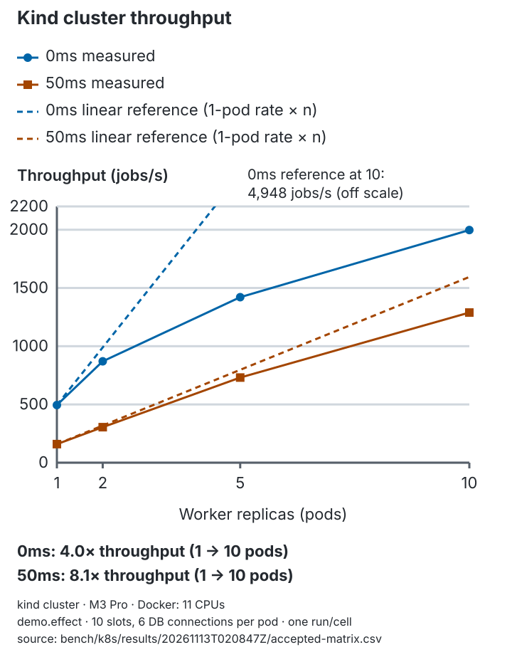

# Results

All numbers below were measured, not estimated. Raw CSVs are in [`bench/results/20261106T050117Z/`](../bench/results/20261106T050117Z/), and `env.txt` there records the environment.

## Setup

| | |
|---|---|
| Machine | Apple M3 Pro, 11 CPUs, 18 GiB RAM, macOS (darwin/arm64), laptop on AC power |
| PostgreSQL | 17.11 (Homebrew), on the same machine as the workers. Default settings: `shared_buffers=160MB`, `max_connections=100`, `synchronous_commit=on`, `fsync=on` |
| Go | 1.27.3 |
| Code | git `8fa4341` (clean tree) |
| Workers | Separate OS processes (`durableq worker`), `--poll 100ms`. Pool size per process = `min(concurrency+2, 80/procs)` |

**Reproduce:** `DATABASE_URL=… go run ./cmd/durableq bench` (defaults shown here), on an otherwise idle database. Each benchmark runs in its own fresh schema. The connection and wait-event sampling matches every `durableq-worker-%` session in the database, so concurrent runs would pollute each other.

**Caveats:** this is a single laptop, with Postgres and workers sharing CPU, and none of it is a dedicated server. `synchronous_commit=on` means every job transition waits for a WAL flush to the laptop SSD. One run per cell, without repetitions or confidence intervals. Treat the figures as orders of magnitude and relative comparisons, not capacity planning numbers.

## Throughput

The `demo.noop` handler on a pre-enqueued backlog of 20,000 jobs. Throughput is `jobs / (last finished_at − first claimed_at)`, both from the database, so process startup is excluded. Each job costs at least two committed transactions: the claim (batched, up to 10 per statement) and the completion.

| procs × concurrency | pool/proc | jobs/s | peak worker conns | top wait events (sampled every 100ms) |
|---|---|---:|---:|---|
| 1 × 1 | 3 | 398 | 1 | running 62%, ClientRead 30%, WalWrite 8% |
| 1 × 10 | 12 | 2,423 | 10 | ClientRead 81%, running 15% |
| 1 × 50 | 52 | 4,514 | 21 | ClientRead 86%, running 10% |
| 2 × 1 | 3 | 770 | 2 | running 57%, ClientRead 35% |
| 2 × 10 | 12 | 4,848 | 20 | ClientRead 80%, running 15% |
| 2 × 50 | 40 | 8,623 | 80 | ClientRead 92%, running 5% |
| 4 × 1 | 3 | 1,577 | 4 | running 56%, ClientRead 32% |
| 4 × 10 | 12 | 7,710 | 40 | ClientRead 78%, running 15% |
| 4 × 50 | 20 | 10,523 | 80 | ClientRead 83%, LWLock:BufferContent 5% |
| 8 × 1 | 3 | 2,093 | 8 | running 72%, ClientRead 12%, LWLock:WALWrite 6% |
| 8 × 10 | 10 | 8,701 | 80 | ClientRead 82%, LWLock:BufferContent 3% |
| 8 × 50 | 10 | 10,946 | 80 | ClientRead 60%, LWLock:BufferContent 10% |

What the numbers show:
- **Single-claimer throughput is bound by commit latency.** At 1 × 1, each job is a serial sequence of round trips plus WAL flushes, at about 2.5ms per job. Adding single-concurrency processes scales linearly up to 4 (398 → 770 → 1,577/s). Beyond that, scaling is sublinear: 8 × 1 reaches 2,093/s, and 4 × 10 (40 concurrent) reaches 7,710/s, about 19× the single claimer for 40× the concurrency.
- **It plateaus around 10–11k jobs/s from 200 concurrent jobs upward,** at the 80-connection budget. Beyond that point, more concurrency doesn't help: 4 × 50 and 8 × 50 are within 4% of each other.
- **`SKIP LOCKED` keeps claimers from serializing.** Even at 400 concurrent jobs there is no heavyweight `Lock:tuple` or `Lock:transactionid` wait in the top three. The contention that does appear is `LWLock:BufferContent`, which grows from 3% to 10% between 8 × 10 and 8 × 50. That is many backends touching the same few heap and index pages at the head of the queue. This is the first scalability limit, and it's the one the PRD's "OR in the claim query" risk anticipates. We have not split the claim query, because at this scale the measured cost is still small.
- `ClientRead` (a backend waiting for the client's next statement) dominates every cell from 10 concurrency upward. Much of the time goes to round trips and the Go side, not to Postgres work. Its share drops to 60% at 8 × 50 as `BufferContent` contention rises. We didn't profile CPU split between processes, so we can't say which side saturates first on this laptop.

**Table bloat.** `n_dead_tup` on `jobs` after a run is 40,000 for 20,000 jobs in 10 of 12 cells. That's exactly two dead tuples per job (the claim UPDATE and the completion UPDATE). In the two longest runs (1 × 1 at 50s and 2 × 1 at 26s), autovacuum ran mid-run and the counts were 26,549 and 20,362. The schema doesn't tune autovacuum per table, and there is no retention, which is a stretch goal. A long-lived deployment would need both.

## Queue latency

Open-loop arrivals: 200 jobs/s for 10s (2,000 jobs), with 4 processes × 10, poll 100ms. Latency is `job_attempts.claimed_at − jobs.run_at` for first attempts, measured on the database clock.

| p50 | p95 | p99 |
|---:|---:|---:|
| 21.5 ms | 70.4 ms | 83.4 ms |

Polling sets these numbers. An idle worker sleeps `poll ± 20%`, so a job that arrives while every worker sleeps waits up to about 120ms. Four workers polling independently cut the expected wait. `LISTEN/NOTIFY` (stretch) would remove most of it.

## Crash recovery

20 long `demo.effect` jobs are held by one worker (lease 2s, heartbeat 500ms). It is SIGKILLed, and a fresh worker starts. Recovery is the time from the kill (database clock, read right after the process is reaped) to each job's next `claimed_at`.

| jobs | lease | p50 | max |
|---:|---:|---:|---:|
| 20 | 2s | 1,992 ms | 1,994 ms |

Recovery is bounded by the lease, as designed: the lease runs from the last successful heartbeat, which was up to 500ms *before* the kill, so the remaining lease is at most 2s. The reclaiming worker then has its next 100ms poll on top. This lands just under one lease length. The lease is the main setting for trading recovery speed against the heartbeat load and false expiries under stalls.

## Chaos reliability

| Run | Jobs | Faults per run | Result |
|---|---:|---|---|
| `bench` (seeds 1–5), pre-audit harness | 1,000 | 20 SIGKILL, 5 conn-kill rounds, 2 stalls, all failpoints at 0.2% | **5/5 passed** I1–I7 |
| Acceptance, post-audit harness (seeds 1000–1019) | 10,000 | 100 SIGKILL, 90–125 failpoint self-kills, 20 conn-kill rounds (227–323 connections), 5 stalls, 10 graceful restarts (67–87 jobs released) | **20/20 passed** I1–I7 |
| `TestPostgresRestart`, 6 local runs (Docker PG 17) | 3,000 | 3 Postgres crash-restarts (`docker restart -t 0`), 10 SIGKILL; 179–209 attempts abandoned per run | **6/6 passed** I1–I7, 0 dead |
| `durableq demo --seed 7` (transcript below), post-audit | 10,000 | 120 SIGKILL, 103 self-kills, 30 conn-kill rounds, 5 stalls, 10 restarts | passed |

The *post-audit harness* (see "Audit" below) counts a fault only when it took effect on a live worker, scopes faults to the run's own workers, and stops every worker before checking the invariants. The `bench` reliability figure predates it.

Across the 20 post-audit acceptance runs:
- 199,974 jobs succeeded and 26 went dead.
- 41,131 attempts were abandoned (at-least-once re-executions on 34,549 jobs).
- 431 stale transitions were rejected by the fence, and 449 leases were abandoned on the local deadline.
- Duplicate effects: 0. Duplicate terminal transitions: 0. Lost jobs: 0.
- Drain time was 27.6–34.5s.

**Why jobs died.** 17 of the 26 dead jobs never failed in their handler: abandoned attempts (kills, lost leases) used up their budget. The other 9 died on a failed final attempt. At a 5% failure rate, five consecutive handler failures are expected about 0.06 times in 200,000 jobs, so those 9 had also lost earlier attempts to faults. This is the attempt-budget tradeoff (design.md §5): crashes count against the budget, so heavy chaos dead-letters some healthy jobs. The pre-audit report didn't distinguish causes ("41 jobs went dead"); the report now does.

Reproduce with:

```sh
go test -tags chaos ./test/chaos/ -run 'TestChaos$' -timeout 0 -v -args \
  -jobs 10000 -kills 100 -conn-kills 20 -stalls 5 -restarts 10 -sleep-ms 100 -seeds 20 -seed 1000
```

The seed fixes the harness's fault schedule. Worker-side randomness (failure rate, failpoints, jitter) is not seeded.

## Chaos demo transcript

```sh
docker compose run --rm demo            # Postgres + 10,000 jobs, 6 workers, 120 SIGKILLs
# port 5432 already taken by a local Postgres?  DURABLEQ_PG_PORT=55432 docker compose run --rm demo
# or, against your own Postgres:
go run ./cmd/durableq demo --jobs 10000 --workers 6 --kills 120 --seed 7
```

Real output (`durableq demo --seed 7`, Apple M3 Pro, PostgreSQL 17.11):

```
Enqueued 10000 jobs · 6 workers × 10 · lease 2s · failpoints "after_claim=0.002,during_run=0.002,before_complete=0.002,in_complete_tx=0.002,after_commit=0.002"
[00:01] SIGKILL worker-4 (pid 66498) … respawned
[00:01] SIGKILL worker-5 (pid 66441) … respawned
[00:01] SIGKILL worker-5 (pid 66548) … respawned
[00:01] SIGKILL worker-3 (pid 66500) … respawned
[00:01] SIGKILL worker-2 (pid 66438) … respawned
…
Drained in 40.4s (seed 7, schema chaos_7_1793947041373928000)
  Jobs succeeded       9996     dead 4 (2 after a failed final attempt, 2 with the budget exhausted by abandoned attempts)
  Worker kills         120      self-kills (failpoints) 103
  Connection kills     30       (578 connections terminated)
  Worker stalls        5        graceful restarts 10 (jobs released 74)
  Abandoned attempts   2346     jobs possibly executed more than once 1941
  Retries              622      stale transitions rejected 24
  Leases lost (worker abandoned job on its local deadline) 23
  I1 PASS no lost jobs: every job is terminal
  I2 PASS no duplicate effects
  I3 PASS every succeeded demo.effect job has exactly one effect, and every effect's job succeeded
  I4 PASS dead jobs have no effects
  I5 PASS each effect was written by the job's final owner
  I6 PASS attempt budget respected
  I7 PASS at most one terminal attempt per job
All 7 invariants PASSED
```

"Jobs possibly executed more than once" counts at-least-once re-executions. Those are expected. Duplicate *effects* or acknowledgments would be bugs, and I2, I5 and I7 catch them. To show the checker works, removing the attempt check from completion makes I5 fail (see [results.md](#the-checker-catches-a-fencing-bug)).

## The checker catches a fencing bug

To prove the invariants can fail, we temporarily removed `AND attempt = $2` from the completion's WHERE clause, keeping the state and lease checks. Then we ran a workload where a stalled worker's jobs outlast its stall: 600 jobs of 1–3s each, 4 workers, 15 SIGSTOPs of 3s with a 2s lease, and no other faults.

| Build | Seed | Result |
|---|---|---|
| Bug injected | 4242 | **I5 FAIL (8 violations)**: effects written by a stale attempt |
| Bug injected | 4243 | **I5 FAIL (4 violations)** |
| Bug injected | `TestStalledWorkerFenced` | **I5 FAIL (11 violations)**; 50 after the audit, because workers are now stopped before the check, so late stale completions are always judged |
| Correct | 4242 | PASS: 19 stale completions rejected by the fence |

In this workload, the stale worker's completion overwrites the job while the new owner is still running. The new owner's own completion then fails the state check, so exactly one effect remains (I2 and I3 still pass). But that effect carries the stale attempt number, and I5 catches it. This is why `effects` has no unique constraint on `job_id`, and why I5 compares attempt numbers instead of only counting rows.

The first attempt at this experiment used 300ms jobs and **did not** catch the bug. New owners always finished before stalled workers resumed, so the state check alone rejected every stale completion. The longer-job workload is now permanent in `TestStalledWorkerFenced`, which fails with the bug and passes without it. The code was reverted, and `queries.go` matches the commit.

## Audit: two defects the original suite missed

A self-review plus an independent Codex review (2026-11-05) found no critical issues but eight majors, all fixed on `audit-fixes`. Two were behavioral defects that the chaos suite, as first written, could not see:

- **A graceful restart dead-lettered jobs on their last attempt.** Release left the attempt consumed, so the next claim exceeded the budget. The harness only sent SIGTERM after the queue drained, so it never exercised this. Graceful restarts are now a chaos fault. With release fixed to raise the budget by one, and then with that fix reverted, on the same workload (1,500 jobs, `max_attempts=1`, 20 restarts, seed 5):

  | Build | Released | Dead | I6 |
  |---|---:|---:|---|
  | Fix reverted | 165 | 165 | **FAIL (165 violations)** |
  | Fixed | 156 | 0 | PASS |

  `TestGracefulRestartsKeepBudget` keeps this workload permanently.
- **Workers claimed job kinds they had no handler for** and dead-lettered them. The claim now filters by registered kind (`TestWorkersClaimOnlyRegisteredKinds`).

The other findings concerned the evidence itself: invariants checked before stalled workers stopped, fault counters that counted signals that didn't land, connection kills that reached other runs' workers, and a race test that could pass with completion broken. Each was fixed so the suite would catch the bugs it claims to catch. The full list is in [PROGRESS.md](PROGRESS.md#audit-2026-11-05-branch-audit-fixes).

## Kubernetes charts

The separate kind setup, workloads and replica matrix are documented in [Kubernetes results](results-k8s.md#throughput-by-replica-count). These measurements are not comparable to the host-Postgres benchmark above.

<picture>
  <source media="(prefers-color-scheme: dark)" srcset="assets/charts/k8s-throughput-dark.svg">
  
</picture>
